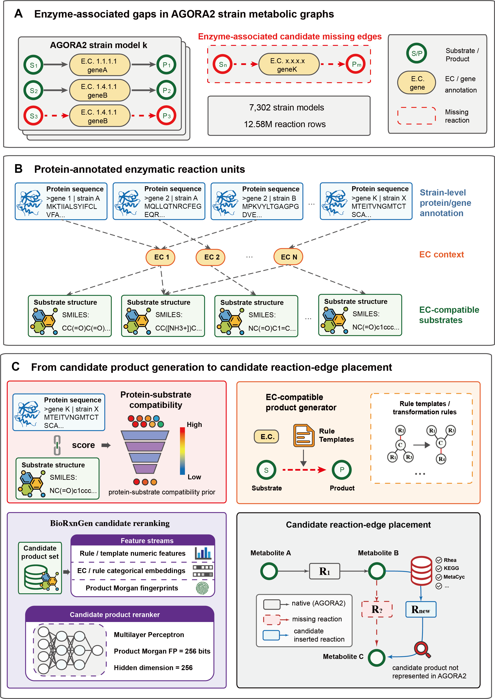

# BioRxnGen

BioRxnGen generates strain-resolved candidate reaction hypotheses from enzyme annotations and EC-compatible transformation rules.



## Contents

| Directory | Contents |
|---|---|
| [code](code) | Methods, trained models, configurations and tests |
| [data](data) | Samples, benchmark scores and [source-data workbooks](data/results) |

## Install and run

From the repository root, with Python 3.11 or later:

```bash
python -m venv .venv
# Windows PowerShell: .\.venv\Scripts\Activate.ps1
# macOS/Linux: source .venv/bin/activate
python -m pip install -r code/environment/requirements-validated.txt
python -m pip install --no-deps -e ./code
python -m pytest code/tests -q -p no:cacheprovider
python code/examples/generation.py
python code/scripts/benchmark.py internal --check
```

The generation example uses synthetic inputs; Fig. 2 evaluation uses saved scores. Full-data commands are in the [reproduction guide](code/docs/REPRODUCTION.md).

## Data downloads

Full data: [v1.0.0](https://github.com/Selenefreeze/BioRxnGen/releases/tag/v1.0.0). Examples and saved-score evaluation require no downloads.

| Archive | Contents | Size |
|---|---|---:|
| [model_and_generation_inputs.zip](https://github.com/Selenefreeze/BioRxnGen/releases/download/v1.0.0/model_and_generation_inputs.zip) | Processed AGORA2 inputs and rules | 674.2 MiB |
| [candidate_reactions_standard.zip](https://github.com/Selenefreeze/BioRxnGen/releases/download/v1.0.0/candidate_reactions_standard.zip) | Standard candidate products | 850.0 MiB |
| Regenerated products: [1](https://github.com/Selenefreeze/BioRxnGen/releases/download/v1.0.0/candidate_reactions_regenerated_part01.zip), [2](https://github.com/Selenefreeze/BioRxnGen/releases/download/v1.0.0/candidate_reactions_regenerated_part02.zip), [3](https://github.com/Selenefreeze/BioRxnGen/releases/download/v1.0.0/candidate_reactions_regenerated_part03.zip) | Regenerated products; all 3 parts | 3.61 GiB |
| [reranker_inputs.zip](https://github.com/Selenefreeze/BioRxnGen/releases/download/v1.0.0/reranker_inputs.zip) | Candidate features and reference reactions | 4.5 MiB |
| [external_benchmark.zip](https://github.com/Selenefreeze/BioRxnGen/releases/download/v1.0.0/external_benchmark.zip) | External benchmark records | 21.6 MiB |
| [case_verification.zip](https://github.com/Selenefreeze/BioRxnGen/releases/download/v1.0.0/case_verification.zip) | Case inputs and full generation records | 178.5 MiB |
| [protein_substrate_compatibility.zip](https://github.com/Selenefreeze/BioRxnGen/releases/download/v1.0.0/protein_substrate_compatibility.zip) | ESP inputs and representations | 191.4 MiB |
| [reaction_database_matching.zip](https://github.com/Selenefreeze/BioRxnGen/releases/download/v1.0.0/reaction_database_matching.zip) | Signatures and Rhea tables | 8.8 MiB |

Extract selected archives into `data/full_artifacts/`. Download all three regenerated-product parts and extract each ZIP. The input archive contains processed AGORA2 tables, not original model SBML files. Table descriptions are in [data_manifest.tsv](data/data_manifest.tsv).

## Contact

- **Shengbo Wu**, School of Medicine, Nankai University: [wushengbo@tju.edu.cn](mailto:wushengbo@tju.edu.cn).
- **Fei Guo**, School of Computer Science and Engineering, Central South University: [guofei@csu.edu.cn](mailto:guofei@csu.edu.cn).

## References

1. Heinken, A. et al. Genome-scale metabolic reconstruction of 7,302 human microorganisms for personalized medicine. *Nature Biotechnology* **41**, 1320-1331 (2023). [AGORA2](https://doi.org/10.1038/s41587-022-01628-0).
2. Kroll, A. et al. A general model to predict small molecule substrates of enzymes based on machine and deep learning. *Nature Communications* **14** (2023). [ESP](https://doi.org/10.1038/s41467-023-38347-2).
3. Heid, E. et al. EnzymeMap: curation, validation and data-driven prediction of enzymatic reactions. *Chemical Science* **14**, 14229-14242 (2023). [EnzymeMap](https://doi.org/10.1039/D3SC02048G).
4. [Rhea](https://www.rhea-db.org/help/download) ([CC BY 4.0](https://www.rhea-db.org/help/license-disclaimer)).
5. [ESM1b](https://github.com/facebookresearch/esm).
